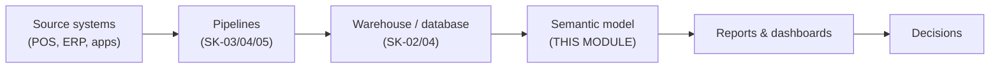

# Lab 01 — Power BI & BI Concepts: Your First (Deliberately Naive) Report

> **Goal:** Understand what BI and the Power BI ecosystem are, then build a first report straight on NorthStar's OLTP tables — and watch it break in four specific ways that the rest of the module (and the guided lab) fixes.
> **Time:** 3–4 hours | **Difficulty:** Beginner | **Prerequisites:** Lab 00 (Power BI Desktop with Auto date/time off; `sk06-postgres` running with the NorthStar data loaded)
> **Guided lab coverage:** SCENARIO, WHY THIS SCENARIO and WHAT YOU WILL BUILD — the business problem, and why the guided lab builds a star schema instead of reporting on the source tables
> **Produces:** `C:\DataEngineering\sk06\pbix\NorthStar_Lab01.pbix` (a "museum piece" — later labs start fresh)

## Learning objectives

By the end of this lab you can:

- Explain what Business Intelligence (BI) is, who consumes it and where it sits after the pipelines you built in SK-01 to SK-05.
- Name the parts of the Power BI ecosystem (Desktop, Service, Mobile, Report Server, Fabric) and the three layers inside a `.pbix` (queries, semantic model, report).
- Import tables from PostgreSQL, build visuals, and explain each visual as an implicit `GROUP BY` query.
- Use slicers and cross-filtering.
- State the four ways a report built directly on OLTP tables fails, and which lab fixes each.

**Key terms**

| Term | Meaning |
|---|---|
| **BI (Business Intelligence)** | Turning stored data into information people act on: reports, dashboards, self-service exploration. |
| **Semantic model** | A business-friendly layer of tables, relationships and named calculations between raw data and visuals. "Revenue" is defined once; every report reuses it. |
| **Import mode** | Power BI copies the data into its in-memory model (fast; refreshed on a schedule). Used throughout SK-06. |
| **DirectQuery** | Data stays in the source; every visual sends a live query (always current, usually slower). |
| **Default aggregation** | What Power BI does with a numeric column dropped on a visual — usually **Sum** (the `Σ` icon). |
| **Cross-filtering** | Clicking a data point in one visual filters the others on the page. |

### BI in your value chain



NorthStar's CFO gets a 40-page Excel report every Monday, compiled by three analysts over the weekend. It is slow (30 analyst-hours a week), stale (Friday's data on Monday), not interactive ("show me just the West" means another email), and untrusted (one analyst's "revenue" is gross, another's is net). BI replaces the spreadsheet with one model that everyone queries.

### The Power BI ecosystem

| Component | What it is | Cost | Used in SK-06? |
|---|---|---|---|
| **Power BI Desktop** | Windows authoring app: get data, model, calculate, design | Free | Yes — every lab |
| **Power BI Service** | Cloud portal (app.powerbi.com): publish, share, refresh, security, apps | Pro / Premium Per User licence or capacity to share | Lab 06 |
| **Power BI Mobile** | Phone/tablet apps showing published reports | Free apps | Lab 06 (mobile layout) |
| **Power BI Report Server** | On-premises report portal | Paid | Awareness only |
| **Microsoft Fabric** | Unified analytics platform; Power BI is one of its workloads | Capacity | SK-07 |

Mental model: **Desktop is the workshop, the Service is the gallery.**

### Inside a `.pbix`

1. **Queries (Power Query / M)** — how data is fetched and shaped (Lab 02).
2. **Semantic model** — the imported, compressed data (VertiPaq), relationships and DAX measures (Labs 03–05).
3. **Report** — pages of visuals bound to the model (Lab 06).

Debugging follows the same layers: is the *source* wrong, the *query*, the *model/measure*, or the *visual's filters*?

### The views in Desktop

The icons down the left edge: **Report** (canvas), **Table** (rows in the model), **Model** (diagram of tables and relationships), and in current versions **DAX query** (run DAX queries) and **TMDL** (model as text). You will use the first four.

## Steps

### Step 1 — Start the database and create the file

```powershell
Set-Location C:\DataEngineering\sk06
docker compose start
docker exec sk06-postgres pg_isready -U postgres
```

**Expected output:** `/var/run/postgresql:5432 - accepting connections`.

Open Power BI Desktop → close the start dialog → **File → Save As** → `C:\DataEngineering\sk06\pbix\NorthStar_Lab01.pbix`.

*Why save first?* Naming and versioning from minute one is a production habit: one file per lab, meaningful names.

✅ **Checkpoint:** `NorthStar_Lab01.pbix` exists in the `pbix` folder.

### Step 2 — Import two OLTP tables the naive way

1. **Home → Get data → More… → PostgreSQL database → Connect**.
2. Server `localhost:5434`, Database `northstar`, mode **Import** → **OK**. (Credentials are remembered from Lab 00; if asked, **Database** tab, `postgres` / `postgres`.)
3. In the Navigator, tick **`sales.orders`** and **`sales.order_lines`**. Click a table name to preview it.
4. Click **Load** (not *Transform Data* — that is Lab 02's door).

**Expected output:** a loading dialog counting rows, then two tables in the Data pane (`sales orders`, `sales order_lines`). Switch to **Table view** and select each table; the status bar at the bottom shows the row count:

| Table | Rows |
|---|---|
| `sales orders` | 177,070 |
| `sales order_lines` | 310,024 |

Now open **Model view**. Power BI has already drawn a line between the two tables: it **imported the foreign key** `order_lines.order_id → orders.order_id` from PostgreSQL. Click the line: *Many to one (\*:1)*, *Single* cross-filter direction. Filters flow from `orders` (one side) to `order_lines` (many side).

✅ **Checkpoint:** both tables loaded with the row counts above, and one relationship line between them.

### Step 3 — First visuals: a card and a trend

1. **Report view** → click empty canvas → **Visualizations** pane → **Card**. Drag `sales order_lines[quantity]` onto it.
2. Click empty canvas → **Line chart**. Drag `sales orders[order_date]` to **X-axis** and `sales order_lines[quantity]` to **Y-axis**.

**Expected output:** the card shows **496.49K** (hover or widen it: 496,488 units). The line chart shows one point per day from July 2023 to June 2026 — a jagged line with weekend spikes and high peaks every November–December.

**What just happened:** you never wrote SQL, but Power BI ran the equivalent of

```sql
SELECT o.order_date, SUM(ol.quantity)
FROM sales.orders o JOIN sales.order_lines ol ON ol.order_id = o.order_id
GROUP BY o.order_date;
```

Every visual is an implicit `GROUP BY`. The `Σ` next to `quantity` in the Data pane is its **default aggregation** (Sum). The filter on dates travelled across the relationship from `orders` to `order_lines`.

Because Auto date/time is **off**, `order_date` appears as a plain date — no Year/Quarter/Month hierarchy. If you *do* see a hierarchy, go back to Lab 00 Step 3, then remove and re-add the field.

✅ **Checkpoint:** the card shows 496,488 and the line spans three years.

### Step 4 — Interactivity: slicer and cross-filtering

1. Add a **Slicer**; drag `sales order_lines[store_id]` into it. Pick store **101**.
2. Watch the card and the line chart re-filter instantly. Clear the selection.
3. Click a single point on the line chart: the card shows only that day's quantity. Click the same point again (or empty space) to clear.

**Expected output:** with store 101 selected, the card shows a much smaller number and the line is thinner.

This is the first business reason Power BI exists: the CFO can answer "what about just *this*?" herself, without an email to an analyst.

✅ **Checkpoint:** selecting a store changes every visual on the page.

### Step 5 — Watch the naive report break (four failures)

Work through each failure on the canvas. Say each one out loud — they are classic interview answers.

**Failure 1 — The business speaks names, the source speaks ids.** The CFO asks: "Show me quantity **by region**." The slicer only offers store *numbers*. Region lives three joins away: `order_lines.store_id → stores → districts → regions`. Try it: **Get data → PostgreSQL** again and also load `sales.stores`, `sales.districts` and `sales.regions`. Model view now shows a chain of four tables just to reach a region name, and the full source has 11 tables and 10 relationships. A slicer on `sales regions[region_name]` works, but every visual walks the whole chain, and a business user faces a maze of `_id` columns.
*Fix: Lab 02 flattens each hierarchy into one dimension table (`dim_store`, `dim_product`), and Lab 03 arranges them as a star — the guided lab's Part 1.*

**Failure 2 — There is no revenue.** NorthStar's revenue is **net revenue = quantity × unit_price − discount_amount**, per line, then summed. Add a card with `sales order_lines[unit_price]`: it shows **20.66M** — the *sum of prices* over 310,024 lines, a meaningless number. Sum of quantity × sum of price is also wrong (multiply-then-sum ≠ sum-then-multiply). There is no drag-and-drop path to the correct figure, and no column for product cost, so margin is impossible too.
*Fix: Lab 02 computes `net_revenue`, `total_cost` and `gross_margin` per line in SQL/Power Query; Lab 04 defines measures such as `Net Revenue` once, centrally.*

**Failure 3 — The calendar is wrong for this business.** NorthStar's fiscal year starts on 1 July (FY2026 = 1 July 2025 – 30 June 2026). Nothing in the source knows that: there is no fiscal year column to slice by, and a "year" built from `order_date` would be January–December. Also open Table view on `sales orders` and sort `ship_date`: **1,759 orders** have no ship date (never shipped) — a second date that needs its own handling.
*Fix: Lab 02 builds `dim_date` with fiscal columns; Lab 03 relates it to both order date (active) and ship date (inactive); Lab 05 uses the fiscal year in time intelligence.*

**Failure 4 — Columns nobody needs.** `sales orders` carries `created_by` and `source_system` (audit/pipeline fields); `order_lines` carries `order_line_id` and `line_number`. They are imported, compressed and held in RAM for no reporting purpose. Check the file size: save, then in PowerShell

```powershell
Get-Item C:\DataEngineering\sk06\pbix\NorthStar_Lab01.pbix | Select-Object Name, @{n='MB'; e={[math]::Round($_.Length / 1MB, 1)}}
```

Note the MB value — you will compare it with the star-schema model later.
*Fix: Lab 02 selects only the needed columns (and pushes the joins to SQL); Lab 06 measures the effect with Performance Analyzer.*

✅ **Checkpoint:** you can state all four failures and have seen each one in your own file.

### Step 6 — Label the museum piece and save

1. Double-click the page tab (bottom left) → rename it `Naive OLTP View`.
2. **Insert → Text box** at the top: "Lab 01 — naive report on OLTP tables. Known issues: ids not names, no revenue, no fiscal calendar, unneeded columns." Labelling a known-bad artefact means nobody mistakes it for the real thing later.
3. **Ctrl+S**.

✅ **Checkpoint:** `NorthStar_Lab01.pbix` reopens without errors and shows the label.

## Troubleshooting

| Symptom | Cause | Fix |
|---|---|---|
| *Unable to connect* / *No connection could be made* | Container stopped | `docker compose start` in `C:\DataEngineering\sk06`. |
| Navigator shows no `sales` tables | Load script not run, or connected to the wrong database | Check the database is `northstar`; rerun Lab 00 Step 8. |
| X-axis shows Year / Quarter / Month / Day | Auto date/time still on for this file | Options → CURRENT FILE → Data Load → uncheck Auto date/time; remove and re-add the field. |
| Card shows a count instead of a sum | Column typed as text, or aggregation changed | Click the field's dropdown in the visual → **Sum**; check the column type in Table view. |
| No relationship line between orders and order_lines | *Import relationships from data sources* is off | Options → CURRENT FILE → Data Load → tick it, or create the relationship manually: drag `order_lines[order_id]` onto `orders[order_id]`. |
| Visuals filter by store but the line chart stays the same | Line chart uses a field from a table the slicer cannot reach | Check Model view: filters flow from the one side to the many side only. |
| Loading is slow | 310,024 rows over a local connection | Normal for a first import (under a minute); later labs import a narrower table. |

## Key takeaways

- BI is the last mile: if the dashboard is wrong, the whole data platform is "wrong" to the business.
- A `.pbix` = queries + semantic model + report. Keep the layers straight and debugging becomes tractable.
- Every visual is an implicit `GROUP BY`; filters flow along relationships from the one side to the many side.
- Reporting straight on OLTP tables fails in four predictable ways, each with a lab: names not ids → Labs 02–03; no revenue definition → Labs 02 & 04; no fiscal calendar → Labs 02, 03 & 05; unneeded columns → Labs 02 & 06.

**Interview check:** *Why can't you get revenue by dragging quantity and unit price?* — Revenue is a row-level calculation (qty × price − discount) that must be computed per row and then summed; default aggregations sum each column separately. *Import vs DirectQuery?* — Import caches data in the fast in-memory engine and refreshes on a schedule (the default for most analytics); DirectQuery queries the source live for freshness or very large data, at a cost in speed and DAX features.

## Next

[Lab 02 — Power Query: Data Ingestion & Transformation](Lab_02_Power_Query_Data_Ingestion_and_Transformation.md): build the guided lab's seven model tables — the fiscal `dim_date` in M, `fact_sales` from native SQL, and flattened dimensions that fold to SQL.
