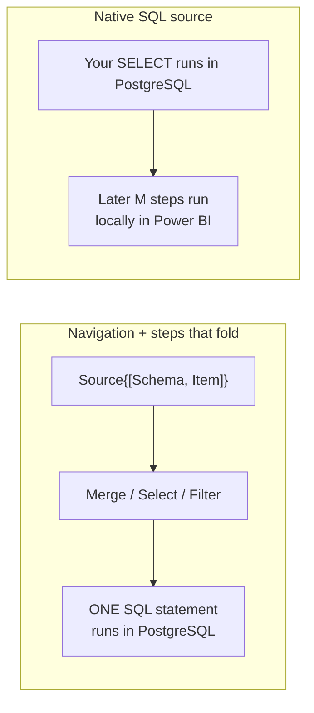

# Lab 02 — Power Query: Data Ingestion & Transformation

> **Goal:** Build the seven model tables of the guided lab in Power Query — the fiscal `dim_date` in M, `fact_sales` from a native SQL query, four flattened dimensions that fold to SQL, and `fact_targets` — using parameters for the server and database.
> **Time:** 5–6 hours | **Difficulty:** Beginner → Intermediate | **Prerequisites:** Labs 00–01 (`sk06-postgres` running and loaded)
> **Guided lab coverage:** PART 0 Step 0.5 (parameters) and PART 2 Steps 2.1–2.3
> **Produces:** `C:\DataEngineering\sk06\pbix\NorthStar_Lab02.pbix` — seven clean tables, no relationships yet

## Learning objectives

By the end of this lab you can:

- Explain Power Query as a recorded, replayable ETL pipeline: queries → applied steps → M code.
- Read and edit M: `let … in`, step names, `each`, `[Column]`, case sensitivity.
- Use **parameters** so a model can be pointed at another server without editing queries.
- Explain **query folding**, check it with **View Native Query**, and say why steps after a native SQL query usually do not fold.
- Build a fiscal date dimension (fiscal year starts 1 July) and verify it.
- Flatten a normalised hierarchy (store → district → region) into one dimension with merges.

**Key terms**

| Term | Meaning |
|---|---|
| **Query** | One table-producing recipe in Power Query. Each loaded query becomes a table in the model. |
| **Applied steps** | The ordered list of transformations in a query. Each step is one line of M and takes the previous step's table as input. |
| **M** | Power Query's functional, **case-sensitive** language (`Table.SelectColumns`, not `table.selectcolumns`). |
| **Parameter** | A named value (here `ServerName`, `DatabaseName`) used inside queries — config separate from code. |
| **Query folding** | Power Query translating steps into the source's language (SQL) so the database does the work. |
| **Native query** | SQL you write yourself and hand to the database (`[Query = "SELECT …"]`). |
| **Dimension / fact** | Descriptive context table (store, product, date) / table of measurable events (sales lines). Lab 03 goes deeper. |
| **Grain** | What one row represents. `fact_sales`: one order line. `fact_targets`: one store per month. |

### Why prepare data in Power Query?

- **Repeatable:** steps re-run identically on every refresh — clean once, benefit forever (the idempotency idea from SK-03, with a GUI).
- **Right layer:** row-level preparation done once per refresh is cheaper than repeating it in every DAX query for every user.
- **Auditable:** the applied-steps list *is* the documentation of what was done to the data.
- **Upstream when possible:** the guided lab pushes joins and arithmetic into PostgreSQL (native SQL or folding), so Power BI imports a narrow, finished result.

### Query folding in one picture



Rule of thumb: put the heavy work where it folds (or in the SQL itself); keep any steps after a native query cheap and row-by-row.

## Steps

### Step 1 — Create the file, show the formula bar, add parameters

1. `docker compose start` in `C:\DataEngineering\sk06` if the container is stopped.
2. Power BI Desktop → **File → Save As** → `C:\DataEngineering\sk06\pbix\NorthStar_Lab02.pbix` (a new, empty file — Lab 01's file stays as the museum piece).
3. **Home → Transform data** opens the **Power Query Editor**. Ribbon **View** → tick **Formula Bar**.
4. **Home → Manage Parameters → New Parameter**, create:

| Name | Type | Current value |
|---|---|---|
| `ServerName` | Text | `localhost:5434` |
| `DatabaseName` | Text | `northstar` |

**Why first?** Hard-coded connection strings break when the report moves (another laptop, the test server, production). In Lab 06 a deployment pipeline changes these two values per environment; nothing else changes.

✅ **Checkpoint:** the Queries pane (left) lists `ServerName` and `DatabaseName`.

### Step 2 — Your first query by clicking: dim_promotion

1. **Home → New Source → More… → PostgreSQL database → Connect**.
2. In *Server*, click the **ABC** dropdown at the left of the box → **Parameter** → `ServerName`. In *Database* → **Parameter** → `DatabaseName`. Mode **Import** → **OK**.
3. Navigator: tick `sales.promotions` → **OK**.
4. **Home → Choose Columns** → keep only `promotion_id`, `promotion_name`, `promotion_type`, `discount_pct`, `start_date`, `end_date` → **OK**.
5. Rename the query (Query Settings pane → Name) to **`dim_promotion`**.
6. **Home → Advanced Editor**. You will see M similar to:

```m
let
    Source = PostgreSQL.Database(ServerName, DatabaseName),
    sales_promotions = Source{[Schema="sales",Item="promotions"]}[Data],
    #"Removed Other Columns" = Table.SelectColumns(sales_promotions,{"promotion_id", "promotion_name", "promotion_type", "discount_pct", "start_date", "end_date"})
in
    #"Removed Other Columns"
```

Read it: `let` introduces named steps; each step uses the previous one; `in` returns the last. `#"…"` quotes step names that contain spaces. `Source{[Schema="sales",Item="promotions"]}[Data]` picks one table out of the database's **navigation table**.

7. Replace the whole text with the guided lab's version (same logic, clearer names) → **Done**:

```m
// dim_promotion
let
    Source     = PostgreSQL.Database(ServerName, DatabaseName),
    Promotions = Source{[Schema = "sales", Item = "promotions"]}[Data],
    Selected   = Table.SelectColumns(Promotions, {
                     "promotion_id", "promotion_name", "promotion_type", "discount_pct",
                     "start_date", "end_date"})
in
    Selected
```

8. Right-click the last step (`Selected`) → **View Native Query**.

**Expected output:** a window with SQL similar to `select "promotion_id", "promotion_name", … from "sales"."promotions"`. The whole query **folded**: PostgreSQL does the work. The preview shows **19 rows** (status bar: "19 rows"), starting with `0 · No Promotion · None`.

✅ **Checkpoint:** `dim_promotion` shows 19 rows and *View Native Query* is clickable.

### Step 3 — Flatten the store hierarchy: dim_store

In the source, a store's region is three tables away (Lab 01, Failure 1). A star schema flattens it into one table.

1. **Home → New Source → Blank Query** → **Advanced Editor** → paste → **Done** → rename the query **`dim_store`**:

```m
// dim_store — store → district → region, flattened
let
    Source         = PostgreSQL.Database(ServerName, DatabaseName),
    Stores         = Source{[Schema = "sales", Item = "stores"]}[Data],
    Districts      = Source{[Schema = "sales", Item = "districts"]}[Data],
    Regions        = Source{[Schema = "sales", Item = "regions"]}[Data],
    JoinDistrict   = Table.NestedJoin(Stores, {"district_id"}, Districts, {"district_id"},
                         "District", JoinKind.Inner),
    ExpandDistrict = Table.ExpandTableColumn(JoinDistrict, "District",
                         {"district_name", "region_id"}, {"district_name", "region_id"}),
    JoinRegion     = Table.NestedJoin(ExpandDistrict, {"region_id"}, Regions, {"region_id"},
                         "Region", JoinKind.Inner),
    ExpandRegion   = Table.ExpandTableColumn(JoinRegion, "Region", {"region_name"}, {"region_name"}),
    Selected       = Table.SelectColumns(ExpandRegion, {
                         "store_id", "store_name", "city", "state", "latitude", "longitude",
                         "district_name", "region_name"})
in
    Selected
```

2. **Walk the applied steps** — click each one in the Query Settings pane and watch the preview:
   - `JoinDistrict` adds a column `District` whose cells say *Table*: a **nested join** (= the **Merge Queries** button, inner join on `district_id`).
   - `ExpandDistrict` opens those tables into real columns (= the ⇔ expand icon on the column header).
   - `JoinRegion` / `ExpandRegion` repeat that for regions.
   - `Selected` keeps only what the report needs (`district_id`, `region_id` and `open_date` are gone).
3. Right-click `Selected` → **View Native Query**.

**Expected output:** one SQL statement with two `inner join`s — three source tables, one query, all executed by PostgreSQL. The preview has **85 rows** and 8 columns; store 101 is `NorthStar Boston #101 · Boston · MA · … · New England · Northeast`.

✅ **Checkpoint:** 85 rows; `region_name` has exactly 4 distinct values (View → tick **Column distribution** to see "4 distinct").

### Step 4 — dim_product and dim_customer

Same pattern. Blank Query → Advanced Editor → paste → rename.

```m
// dim_product — product → subcategory → category, flattened
let
    Source         = PostgreSQL.Database(ServerName, DatabaseName),
    Products       = Source{[Schema = "products", Item = "products"]}[Data],
    Subcategories  = Source{[Schema = "products", Item = "subcategories"]}[Data],
    Categories     = Source{[Schema = "products", Item = "categories"]}[Data],
    JoinSub        = Table.NestedJoin(Products, {"subcategory_id"}, Subcategories, {"subcategory_id"},
                         "Sub", JoinKind.Inner),
    ExpandSub      = Table.ExpandTableColumn(JoinSub, "Sub",
                         {"subcategory_name", "category_id"}, {"subcategory_name", "category_id"}),
    JoinCat        = Table.NestedJoin(ExpandSub, {"category_id"}, Categories, {"category_id"},
                         "Cat", JoinKind.Inner),
    ExpandCat      = Table.ExpandTableColumn(JoinCat, "Cat", {"category_name"}, {"category_name"}),
    Selected       = Table.SelectColumns(ExpandCat, {
                         "product_id", "product_name", "brand", "subcategory_name", "category_name",
                         "list_price"})
in
    Selected
```

```m
// dim_customer — the email column is deliberately NOT imported (personal data, not needed)
let
    Source       = PostgreSQL.Database(ServerName, DatabaseName),
    Customers    = Source{[Schema = "sales", Item = "customers"]}[Data],
    Selected     = Table.SelectColumns(Customers, {
                       "customer_id", "first_name", "last_name", "customer_segment",
                       "registration_date", "city", "state"}),
    AddFullName  = Table.AddColumn(Selected, "customer_name",
                       each [first_name] & " " & [last_name], type text)
in
    AddFullName
```

Notes:

- `unit_cost` is not in `dim_product`: cost is computed per sales line in `fact_sales` (Step 6), so the dimension does not need it.
- `email` is left in the database. Not importing personal data you do not need is the simplest privacy control there is (data minimisation).
- `each [first_name] & " " & [last_name]` — `each` means "for every row"; `[col]` reads that row's column; `&` joins text.

**Expected output:** `dim_product` **12,000 rows** (status bar may say "999+ rows" in the preview — the preview only samples; the full count appears after loading), with 5 distinct `category_name` values. `dim_customer` **30,000 rows**; customer 12000 is `Samuel Wilson`, segment `Value`, registered 2023-07-01.

✅ **Checkpoint:** both queries preview without errors, and *View Native Query* is available on `dim_product`'s last step.

### Step 5 — Build the fiscal date dimension: dim_date

NorthStar's fiscal year starts **1 July** and is named after the year it *ends* in: 1 July 2025 – 30 June 2026 is **FY2026**. The source has no date table, so you build one in M — owned by the BI team, visible, maintainable.

Blank Query → Advanced Editor → paste → rename **`dim_date`**:

```m
// ═══════════════════════════════════════════════════════════════
// dim_date — Complete Fiscal Date Dimension
// Fiscal Year: July 1 (FY2026 = July 1 2025 – June 30 2026)
// ═══════════════════════════════════════════════════════════════
let
    // ── Configuration ─────────────────────────────────────────
    StartDate            = #date(2020, 1, 1),
    EndDate              = #date(2027, 12, 31),
    FiscalYearStartMonth = 7,   // July

    // ── Generate date list ─────────────────────────────────────
    DayCount   = Duration.Days(EndDate - StartDate) + 1,
    DateList   = List.Dates(StartDate, DayCount, #duration(1, 0, 0, 0)),
    DateTable  = Table.FromList(DateList, Splitter.SplitByNothing(), {"Date"}),
    TypedDate  = Table.TransformColumnTypes(DateTable, {{"Date", type date}}),

    // ── Calendar attributes ────────────────────────────────────
    AddYear          = Table.AddColumn(TypedDate, "Year", each Date.Year([Date]), Int64.Type),
    AddMonthNum      = Table.AddColumn(AddYear, "Month Number", each Date.Month([Date]), Int64.Type),
    AddMonthName     = Table.AddColumn(AddMonthNum, "Month Name", each Date.MonthName([Date]), type text),
    AddMonthShort    = Table.AddColumn(AddMonthName, "Month Short",
                           each Text.Start(Date.MonthName([Date]), 3), type text),
    AddQuarter       = Table.AddColumn(AddMonthShort, "Quarter",
                           each "Q" & Text.From(Date.QuarterOfYear([Date])), type text),
    AddDayOfWeek     = Table.AddColumn(AddQuarter, "Day of Week",
                           each Date.DayOfWeek([Date], Day.Monday) + 1, Int64.Type),
    AddDayName       = Table.AddColumn(AddDayOfWeek, "Day Name",
                           each Date.DayOfWeekName([Date]), type text),
    AddWeekNum       = Table.AddColumn(AddDayName, "Week Number",
                           each Date.WeekOfYear([Date]), Int64.Type),
    AddIsWeekend     = Table.AddColumn(AddWeekNum, "Is Weekend",
                           each Date.DayOfWeek([Date], Day.Monday) >= 5, type logical),

    // ── Fiscal Year (starts July 1) ────────────────────────────
    // FY2026 = July 1 2025 to June 30 2026
    AddFiscalYear    = Table.AddColumn(AddIsWeekend, "Fiscal Year",
                           each if Date.Month([Date]) >= FiscalYearStartMonth
                                then Date.Year([Date]) + 1
                                else Date.Year([Date]),
                           Int64.Type),

    // Fiscal month number: July=1, August=2, ... June=12
    AddFiscalMonth   = Table.AddColumn(AddFiscalYear, "Fiscal Month Number",
                           each Number.Mod(Date.Month([Date]) - FiscalYearStartMonth + 12, 12) + 1,
                           Int64.Type),

    // Fiscal quarter
    AddFiscalQtr     = Table.AddColumn(AddFiscalMonth, "Fiscal Quarter",
                           each "FQ" & Text.From(Number.RoundUp([Fiscal Month Number] / 3)),
                           type text),

    // ── Sort keys ──────────────────────────────────────────────
    // Year-Month for sorting (prevents alphabetic month sort)
    AddYearMonthSort = Table.AddColumn(AddFiscalQtr, "Year-Month Sort",
                           each Date.Year([Date]) * 100 + Date.Month([Date]),
                           Int64.Type),
    AddYearMonth     = Table.AddColumn(AddYearMonthSort, "Year-Month",
                           each Text.From(Date.Year([Date])) & "-" &
                                Text.PadStart(Text.From(Date.Month([Date])), 2, "0"),
                           type text),

    // ── Integer date key for relationships ────────────────────
    // YYYYMMDD format — sorts correctly as an integer
    AddDateKey       = Table.AddColumn(AddYearMonth, "DateKey",
                           each Date.Year([Date]) * 10000
                                + Date.Month([Date]) * 100
                                + Date.Day([Date]),
                           Int64.Type),

    // ── US Federal Holidays (static list for the data range) ──
    Holidays = #table(
        type table [HolidayDate = date, HolidayName = text],
        {
            {#date(2023, 7, 4),  "Independence Day"},
            {#date(2023, 11, 23),"Thanksgiving Day"},
            {#date(2023, 12, 25),"Christmas Day"},
            {#date(2024, 1, 1),  "New Year's Day"},
            {#date(2024, 7, 4),  "Independence Day"},
            {#date(2024, 11, 28),"Thanksgiving Day"},
            {#date(2024, 12, 25),"Christmas Day"},
            {#date(2025, 1, 1),  "New Year's Day"},
            {#date(2025, 7, 4),  "Independence Day"},
            {#date(2025, 11, 27),"Thanksgiving Day"},
            {#date(2025, 12, 25),"Christmas Day"},
            {#date(2026, 1, 1),  "New Year's Day"}
        }
    ),

    MergeHolidays    = Table.NestedJoin(AddDateKey, {"Date"}, Holidays, {"HolidayDate"},
                           "HolidayMatch", JoinKind.LeftOuter),
    ExpandHolidays   = Table.ExpandTableColumn(MergeHolidays, "HolidayMatch",
                           {"HolidayName"}, {"Holiday Name"}),
    AddIsHoliday     = Table.AddColumn(ExpandHolidays, "Is Holiday",
                           each [Holiday Name] <> null, type logical),

    // ── Final output — reorder and set types ──────────────────
    FinalTable       = Table.SelectColumns(AddIsHoliday, {
                           "DateKey", "Date", "Year", "Month Number", "Month Name",
                           "Month Short", "Quarter", "Day of Week", "Day Name",
                           "Week Number", "Is Weekend", "Is Holiday", "Holiday Name",
                           "Fiscal Year", "Fiscal Month Number", "Fiscal Quarter",
                           "Year-Month", "Year-Month Sort"
                       })

in
    FinalTable
```

**How the important lines work:**

| Line | What it does |
|---|---|
| `List.Dates(StartDate, DayCount, #duration(1,0,0,0))` | A list of every day from 1 Jan 2020, one day apart. 2,922 days to 31 Dec 2027. The range covers the data (Jul 2023 – Jun 2026) with room on both sides. |
| `Date.DayOfWeek([Date], Day.Monday) + 1` | Monday = 1 … Sunday = 7. The second argument says which day counts as the first. |
| `if Date.Month([Date]) >= 7 then Date.Year([Date]) + 1 else Date.Year([Date])` | The fiscal-year rule: July–December belong to the *next* year's FY. |
| `Number.Mod(Date.Month([Date]) - 7 + 12, 12) + 1` | Shifts months so July = 1 … June = 12. |
| `"FQ" & Text.From(Number.RoundUp([Fiscal Month Number] / 3))` | Fiscal months 1–3 → FQ1, 4–6 → FQ2, … |
| `DateKey` = `YYYY*10000 + MM*100 + DD` | An integer like `20250701` — compact and fast for relationships. |
| `Table.NestedJoin(… JoinKind.LeftOuter)` + expand | Looks up each date in the holiday list; non-holidays get `null`. |

This query has no database source, so there is nothing to fold — M generates the rows itself.

**Verify (do not skip — an off-by-one here poisons every time-intelligence measure in Lab 05):** click the filter arrow on `Date` → **Date Filters → Equals** `2025-07-01`:

| Date | Fiscal Year | Fiscal Month Number | Fiscal Quarter | DateKey | Day Name |
|---|---|---|---|---|---|
| 2025-07-01 | 2026 | 1 | FQ1 | 20250701 | Tuesday |

Change the filter to `2025-06-30` → Fiscal Year **2025**, Fiscal Month Number **12**, Fiscal Quarter **FQ4**. Remove the filter step afterwards (click the ✕ next to it in Applied Steps).

✅ **Checkpoint:** both dates show the values above and no step has an error triangle.

### Step 6 — The fact table from native SQL: fact_sales

`fact_sales` combines three source tables (orders, order_lines, products) and computes revenue and cost per line. Here the guided lab writes the SQL itself and hands it to PostgreSQL.

Blank Query → Advanced Editor → paste → rename **`fact_sales`**:

```m
// ═══════════════════════════════════════════════════════════════
// fact_sales — Sales Fact Table (grain: one row per order line)
// The joins and revenue arithmetic run inside PostgreSQL
// ═══════════════════════════════════════════════════════════════
let
    Source = PostgreSQL.Database(
        ServerName,
        DatabaseName,
        [
            Query = "
                SELECT
                    o.order_id,
                    o.order_date,
                    o.ship_date,
                    o.customer_id,
                    ol.product_id,
                    ol.store_id,
                    ol.promotion_id,
                    ol.quantity,
                    ol.unit_price,
                    ol.discount_amount,
                    ol.quantity * ol.unit_price                         AS gross_revenue,
                    ol.quantity * ol.unit_price - ol.discount_amount    AS net_revenue,
                    p.unit_cost * ol.quantity                           AS total_cost,
                    CASE WHEN o.is_returned = 1 THEN 1 ELSE 0 END       AS is_returned
                FROM   sales.orders o
                JOIN   sales.order_lines ol ON o.order_id = ol.order_id
                JOIN   products.products p  ON ol.product_id = p.product_id
                WHERE  o.order_date >= DATE '2021-01-01'
            "
        ]
    ),

    // Date keys for the two relationships to dim_date
    AddOrderDateKey = Table.AddColumn(Source, "OrderDateKey",
                          each Date.Year([order_date]) * 10000
                               + Date.Month([order_date]) * 100
                               + Date.Day([order_date]),
                          Int64.Type),

    AddShipDateKey  = Table.AddColumn(AddOrderDateKey, "ShipDateKey",
                          each if [ship_date] = null then null
                               else Date.Year([ship_date]) * 10000
                                    + Date.Month([ship_date]) * 100
                                    + Date.Day([ship_date]),
                          Int64.Type),

    // Days between order and shipment (null = never shipped)
    AddDaysToShip   = Table.AddColumn(AddShipDateKey, "days_to_ship",
                          each if [ship_date] = null then null
                               else Duration.Days([ship_date] - [order_date]),
                          Int64.Type),

    // Gross margin calculated in Power Query (not a DAX calculated column —
    // this is a fixed per-row value, not context-sensitive)
    AddMargin       = Table.AddColumn(AddDaysToShip, "gross_margin",
                          each [net_revenue] - [total_cost],
                          Currency.Type),

    // Remove the raw date columns (relationships use date key integers)
    RemoveDates     = Table.RemoveColumns(AddMargin, {"order_date", "ship_date"}),

    // Explicit types — never let Power BI infer
    TypedTable      = Table.TransformColumnTypes(RemoveDates, {
                          {"order_id",        Int64.Type},
                          {"customer_id",     Int64.Type},
                          {"product_id",      Int64.Type},
                          {"store_id",        Int64.Type},
                          {"promotion_id",    Int64.Type},
                          {"quantity",        Int64.Type},
                          {"unit_price",      Currency.Type},
                          {"discount_amount", Currency.Type},
                          {"gross_revenue",   Currency.Type},
                          {"net_revenue",     Currency.Type},
                          {"total_cost",      Currency.Type},
                          {"is_returned",     Int64.Type}
                      })

in
    TypedTable
```

Power Query shows **"Native Database Query — permission is required to run this native database query"**. Click **Edit Permission → Run**. (Power BI asks once per distinct SQL text, because a native query could in principle change data.)

**Read the design decisions:**

- **Business rules live in one place:** `net_revenue = quantity × unit_price − discount_amount` is the CFO's definition of revenue (Lab 01, Failure 2). `total_cost` uses the product's unit cost. Both are computed per line, in SQL.
- **Only needed columns cross the wire:** `created_by`, `source_system`, `order_line_id` and `line_number` are simply not selected (Lab 01, Failure 4).
- **Two date keys:** `OrderDateKey` (every row) and `ShipDateKey` (`null` for the ~1% of lines never shipped). Lab 03 relates both to `dim_date`.
- **Folding:** right-click `AddOrderDateKey` → *View Native Query* is greyed out. The SQL ran on the server, but the M steps *after* a native query run locally. That is fine here — they are cheap row-by-row calculations — but heavy steps (grouping, merging big tables) belong in the SQL.
- **`Currency.Type`** is Power BI's *Fixed decimal number*: four decimal places, no floating-point drift on money.

**Expected output:** 16 columns. Filter `order_id` = 1000001 (then delete the filter step):

| order_id | customer_id | product_id | store_id | quantity | unit_price | net_revenue | total_cost | gross_margin | OrderDateKey | ShipDateKey | days_to_ship |
|---|---|---|---|---|---|---|---|---|---|---|---|
| 1000001 | 12000 | 18707 | 171 | 2 | 28.22 | 56.44 | 36.34 | 20.10 | 20230701 | 20230703 | 2 |

✅ **Checkpoint:** no error triangles; the row above matches.

### Step 7 — The second fact: fact_targets

Finance sets a revenue target **per store per month**, stamped on the 1st of the month. Blank Query → paste → rename **`fact_targets`**:

```m
// fact_targets — one row per store per month
let
    Source    = PostgreSQL.Database(ServerName, DatabaseName),
    Targets   = Source{[Schema = "finance", Item = "revenue_targets"]}[Data],
    AddKey    = Table.AddColumn(Targets, "target_date_key",
                    each Date.Year([target_month]) * 10000
                         + Date.Month([target_month]) * 100
                         + Date.Day([target_month]),
                    Int64.Type),
    Selected  = Table.SelectColumns(AddKey, {"store_id", "target_date_key", "revenue_target"}),
    Typed     = Table.TransformColumnTypes(Selected, {{"revenue_target", Currency.Type}})
in
    Typed
```

**Expected output:** the first rows are store 101 with keys `20230701` (target 8,100.00) and `20230801` (4,400.00).

✅ **Checkpoint:** three columns, every `target_date_key` ends in `01`.

### Step 8 — Close & Apply, check row counts, prove a refresh is repeatable

1. **Home → Close & Apply**. The load dialog lists each query; `fact_sales` takes the longest.
2. **Table view** → select each table and read the row count in the status bar:

| Table | Rows |
|---|---|
| `dim_date` | 2,922 |
| `dim_store` | 85 |
| `dim_product` | 12,000 |
| `dim_customer` | 30,000 |
| `dim_promotion` | 19 |
| `fact_sales` | 310,024 |
| `fact_targets` | 3,060 |

The parameters `ServerName` and `DatabaseName` are not loaded as tables — that is correct.

3. **Home → Refresh**, then refresh again. The counts stay identical: same input, same output, any number of runs (idempotent refresh).
4. Open **Model view**: Power BI may have guessed some relationships. Leave them — Lab 03 deletes and rebuilds them deliberately.
5. **Ctrl+S**.

✅ **Checkpoint:** seven tables with exactly the row counts above.

## Troubleshooting

| Symptom | Cause | Fix |
|---|---|---|
| `Expression.Error: The name 'ServerName' wasn't recognized` | Parameter missing or misspelt (M is case-sensitive) | Check the Queries pane; names must be exactly `ServerName` / `DatabaseName`. |
| `Expression.SyntaxError: Token Comma expected` (or similar) | Paste was cut off or a bracket is missing | Re-paste the whole block from `let` to the final `in` line. |
| `Expression.Error: The column 'district_name' of the table wasn't found` | A typo in a column list | Compare with the code above; column names are case-sensitive. |
| `fact_sales` errors on the `Query` option (an older or unusual PostgreSQL connector build) | Connector does not accept `[Query = …]` | Use the generic form instead: `Source = Value.NativeQuery(PostgreSQL.Database(ServerName, DatabaseName), "SELECT … (same SQL)")`; the remaining steps are unchanged. |
| Native Database Query prompt keeps reappearing | The SQL text changed (even whitespace) | Approve again; or File → Options → GLOBAL → Security → untick *Require user approval for new native database queries* (only on your own machine). |
| *View Native Query* greyed out on `dim_store` | A step was added that does not fold (e.g. a custom column with complex logic) | Remove the extra step; keep foldable steps first. |
| `fact_sales` loads but `ShipDateKey` is empty everywhere | `ship_date` column renamed or removed before `AddShipDateKey` | Steps run in order — the date columns are removed only in `RemoveDates`, after the keys are built. |
| *DataFormat.Error* on `Currency.Type` | A text value in a money column | Should not happen with this data; check you pasted the SQL unchanged. |
| Row counts differ from the table | Data generated differently or load script not rerun | Rerun Lab 00 Steps 7–8, then **Refresh**. |

## Key takeaways

- Every click writes M; read the formula bar until it stops being scary. You can always paste code into **Advanced Editor**.
- Parameters separate configuration from logic — the model can move between servers by changing two values.
- **Navigation + merges fold** into one SQL statement; a **native query** runs your SQL on the server, but later steps usually run locally — keep them light.
- Shape the data for the model: flatten hierarchies into dimensions, compute row-level business rules once (`net_revenue`, `total_cost`, `gross_margin`, `days_to_ship`), import only the columns you need.
- `dim_date` encodes NorthStar's fiscal calendar once: 2025-07-01 is FY2026, FQ1, fiscal month 1.

**Interview check:** *What is query folding and why does it matter?* — Power Query translating steps into the source's query language so the source does the work; it cuts refresh time and memory. Check it with View Native Query and keep foldable steps first. *Where should data cleaning and shaping happen?* — As far upstream as you control: source/pipeline first, Power Query when it is BI-specific, never in DAX visuals.

## Next

[Lab 03 — Data Modeling](Lab_03_Data_Modeling.md): connect the seven tables into the guided lab's star schema — active and inactive relationships, the marked date table, and correct month sorting.
